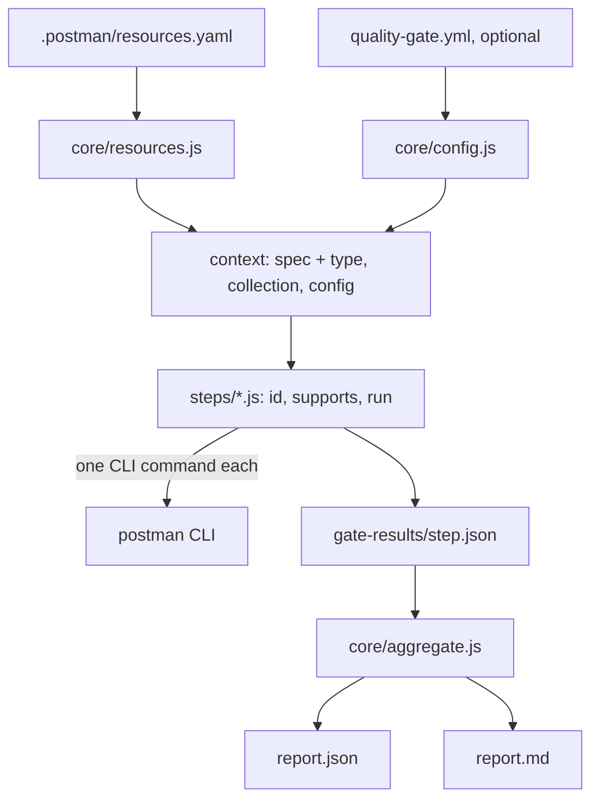

# Architecture

## Principle

The gate reads the **Postman project**: `.postman/resources.yaml`, the spec and the collection it points to. It has no JUnit, no build, no language toolchain. Code-versus-contract conformance belongs to the consuming project's own CI.

## Layers



- `core/config.js`: defaults, validation (every problem listed at once, exit code 2).
- `core/resources.js`: resolves the spec and the collection; several candidates without a choice in the config is a configuration error. `core/spec-type.js` detects `openapi-3`, `openapi-2`, `asyncapi`, `unknown`.
- `core/runner.js`: runs a step safely. A step never throws: a crash, a missing CLI or an unsupported spec type becomes `not_available` with the reason.
- `core/aggregate.js`: the only place that decides.
- `steps/<step>.js`: each exports `{ id, supports, run(ctx) }` plus its pure output parser, isolated so a CLI output change touches one function.

## Step contract

```json
{ "step": "contract-lint", "status": "pass|warn|fail|not_available",
  "score": 0, "summary": "...", "details": [], "command": "postman ..." }
```

`score` is `null` when `not_available`. An optional `degraded: "<reason>"` says the step ran with a weakened check (for example governance lint rules skipped without a login). A missing capability is a gap, never a pass: a degraded step is at best `warn`, its score is capped at 70 (`DEGRADED_SCORE_CAP`), a syntax error still gives `fail` and stays a blocker, and a degraded required step still counts as having run. The field reaches `report.json` (`steps[].degraded`), a "Degraded" section of `report.md` and the feedback. A fallback that reads the same data is not degradation (the `contract-tests` stdout counters). A `details` item may carry `check`, `result`, `hint` (how to fix it, fed to the agent) and, for `impact`, `breaking: true`. Contract is deliberately small and format-agnostic: a future "external step" (a project-provided step JSON dropped in the results folder) only has to write this shape; the aggregation already reads results by id, whoever wrote them. Not built in v1.

## Spec types and adapters

Each step declares `supports` (`openapi-3` today, `*` for steps that do not read the spec). An unsupported type gives `not_available: spec type "asyncapi" is not supported by <step>`. The breaking-change diff is an adapter, `steps/adapters/openapi/contract-diff.js`, which takes the **content** of the base and current specs (no git needed to test it); `impact` picks the adapter from the spec type.

## Scoring

Weights (default): skills-check 10, contract-lint 25, contract-tests 20, coverage 5, ai-readiness 20, impact 20. Not-available steps are left out and the weights re-normalized. Ratings: A 90, B 80, C 70, D 50, else E; `pass_rating` B. All configurable. Step scores: lint `100 - 40*errors - 10*warnings`; contract-tests = pass ratio; coverage = percent; ai-readiness = the CLI score (>= 80 pass, 60-79 warn, < 60 fail, configurable via `ai_readiness`); impact: breaking with consumers 0 (fail), breaking without known consumer 60 (warn), else 100.

Blockers are data: `blockers: { contract-lint: on_fail, impact: on_breaking }` (rules `on_fail`, `on_warn`, `on_breaking`), plus `required_steps` (default `contract-lint`, `contract-tests`): a required step that is `not_available` is a blocker.

## Postman CLI

Pinned in one place: `postmanCli` in `package.json` (1.76.0). The action installs that version. Facts that shaped the steps (see `docs/cli-inventory.md`):

- `collection run` always gets `--no-report-events`: otherwise it uploads run data to Postman Cloud.
- `--use-mock` starts the mock on a random free port and ignores `mock generate --port`: no port to configure.
- `collection run --output` (the YAML report with structured `failures[]`) and governance lint need `postman login`. Without a login, `contract-tests` reads the counters table of stdout (same data, not degraded) and `contract-lint` falls back to `--issueType syntax`, which is flagged `degraded`.
- `context-graph ask` is an LLM: the structured typed query is used when present, the JSON-only text answer is the fallback, and an empty answer is retried up to 3 times.

## CI: one tag, two references

A reusable workflow runs in the **caller's** repository: `actions/checkout` fetches the caller's code, not the gate's. The workflow therefore gets the gate code through the **composite action** `Postman-Devrel/postman-agent-quality-gate@v1`, which runs from `${{ github.action_path }}` (the action's own checkout, at that ref). A `uses:` ref cannot be an expression, so the action ref is written in `gate.yml`. The rule is:

- the caller writes `.../gate.yml@v1`; inside, the action is referenced at the same `@v1`. One moving major tag, two references that must move together;
- a release process moves `v1` (and `v1.x.y`) only after `self-test` is green on that commit, and bumping the major means editing the action ref inside `gate.yml` in the same commit.

Limits:

- A caller that pins the workflow to a SHA or a branch (`gate.yml@<sha>`) still gets the action at `@v1`: the two can drift. To pin tightly, pin both through a fork or tag (`@v1.2.3` needs the inner refs edited at release; not automated in v1).
- The composite action is public-repo friendly. If the repository goes private, callers need the repository's Actions access setting ("accessible from repositories in the organization").
- The runner installs its dependencies on every job (`npm ci --omit=dev`, one package) and the Postman CLI from npm; there is no caching in v1.
- `self-test.yml` uses the local action (`uses: ./`), so the repository tests the code of the commit it runs on, not a tag.

Jobs of `gate.yml`: `changes` (relevant files: `.postman/`, spec and collection, symlink targets included, the config file, plus the `extra-paths` input), a matrix `gate` (one job per step, uploads `gate-<step>`), then `quality-gate` (downloads, aggregates, updates the marked PR comment, fails the check when the gate fails). Same behaviour as the original workflow: one concurrency group per branch, `not_available` when the secret is missing (fork PRs), a skipped report when nothing relevant changed so the check can be required.

Third-party actions are pinned by commit SHA.

## Out of scope in v1

External steps, other spec formats than OpenAPI 3, the Claude Code plugin (`plugin/`, `.claude-plugin/marketplace.json` will live in this repository later), a LICENSE (owner decision), npm publication.
