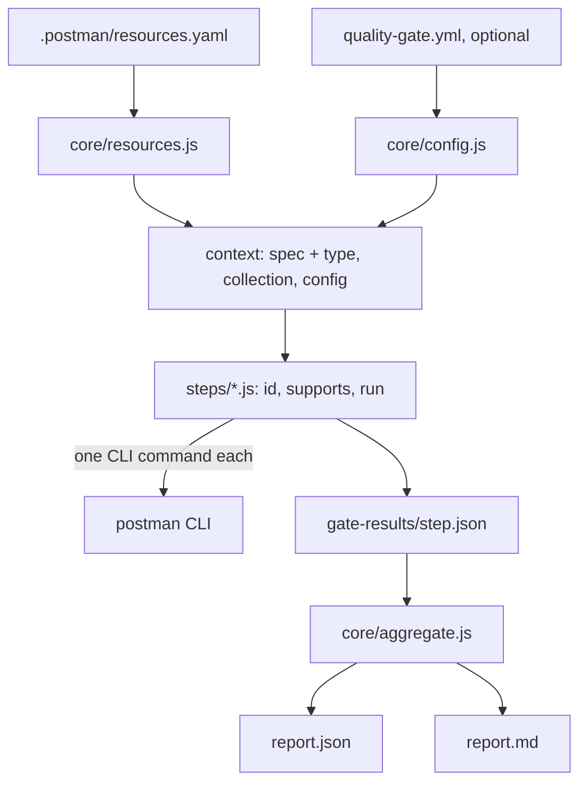

# Architecture

This repository is owned by the healthcare-org-app platform team. Services across the org call the gate from their own CI; it is built on the Postman CLI.

## Principle

The gate reads the **Postman project**: `.postman/resources.yaml`, the spec and the collection it points to. It has no JUnit, no build, no language toolchain. Code-versus-contract conformance belongs to the consuming project's own CI.

## Layers



- `core/config.js`: defaults, validation (every problem listed at once, exit code 2).
- `core/resources.js`: resolves the spec and the collection; several candidates without a choice in the config is a configuration error. `core/spec-type.js` detects `openapi-3`, `openapi-2`, `asyncapi`, `unknown`.
- `core/runner.js`: runs a step safely. A step never throws: a crash, a missing CLI or an unsupported spec type becomes `not_available` with the reason.
- `core/aggregate.js`: the only place that decides.
- `core/quality.js`: the API quality index, the delta, the change risk and the ratchet (pure functions). `core/baseline.js`: where the base commit stood (artifact, rerun on a worktree, or none).
- `steps/<step>.js`: each exports `{ id, supports, run(ctx) }` plus its pure output parser, isolated so a CLI output change touches one function.

## Step contract

```json
{ "step": "contract-lint", "status": "pass|warn|fail|not_available",
  "score": 0, "summary": "...", "details": [], "command": "postman ..." }
```

`score` is `null` when `not_available`. An optional `degraded: "<reason>"` says the step ran with a weakened check (for example governance lint rules skipped without a login). A missing capability is a gap, never a pass: a degraded step is at best `warn`, its score is capped at 70 (`DEGRADED_SCORE_CAP`), a syntax error still gives `fail` and stays a blocker, and a degraded required step still counts as having run. The field reaches `report.json` (`steps[].degraded`), a "Degraded" section of `report.md` and the feedback. A fallback that reads the same data is not degradation (the `contract-tests` stdout counters). A `details` item may carry `check`, `result`, `hint` (how to fix it, fed to the agent) and, for `impact`, `breaking: true`. Contract is deliberately small and format-agnostic: a future "external step" (a project-provided step JSON dropped in the results folder) only has to write this shape; the aggregation already reads results by id, whoever wrote them. Not built in v1.

## Spec types and adapters

Each step declares `supports` (`openapi-3` today, `*` for steps that do not read the spec). An unsupported type gives `not_available: spec type "asyncapi" is not supported by <step>`. The breaking-change diff is an adapter, `steps/adapters/openapi/contract-diff.js`, which takes the **content** of the base and current specs (no git needed to test it); `impact` picks the adapter from the spec type.

## Scoring

Weights (default): skills-check 10, contract-lint 25, contract-tests 20, coverage 5, ai-readiness 20, impact 20. Not-available steps are left out and the weights re-normalized. Ratings: A 90, B 80, C 70, D 50, else E; `pass_rating` B. All configurable. Step scores: lint `100 - 40*errors - 10*warnings`; contract-tests = pass ratio; coverage = percent; ai-readiness = the CLI score (>= 80 pass, 60-79 warn, < 60 fail, configurable via `ai_readiness`); impact: breaking with consumers 0 (fail), breaking without known consumer 60 (warn), else 100.

Blockers are data: `blockers: { contract-lint: on_fail, impact: on_breaking }` (rules `on_fail`, `on_warn`, `on_breaking`), plus `required_steps` (default `contract-lint`, `contract-tests`): a required step that is `not_available` is a blocker.

## API quality delta

A verdict says where a commit stands; the delta says whether the PR moved the API up or down. Choices:

- **The index describes the API, not the repo or the change.** It is the weighted score, with the gate's own weights re-normalized and `not_available` steps left out, over `contract-lint`, `contract-tests`, `coverage` and `ai-readiness`. `skills-check` is repo hygiene and `impact` is a property of the change (breaking or not, for how many consumers): that is reported next to the delta as the **change risk**, never inside it. An API can get better while the change is breaking, and both facts are shown.
- **The sentence compares the gate score (0.6.3).** The first bold line of the comment says how the gate score, the `score` of the rating line, moved against the base's, because that is the number the reader compares it with (before 0.6.3 it used the index and could say "unchanged" under a rating of C caused by `impact`). `scoreDelta()` in `core/quality.js`: the base's score is the `score` of the base commit's gate report (stored in `baseline.score`, `source: artifact`), else reconstructed with the same weights over the head's counted steps (quality steps from `baseline.steps`, `impact` = 100 because the base is the reference, `skills-check` = the head's value, a step the base cannot supply left out of the base side), `source: reconstructed`. It is recorded in `report.json` as `score_delta`; `delta`, `quality_index` and `headline` still describe the index and the ratchet still uses the index delta, so existing consumers of the report do not change.
- **Same steps on both sides.** The delta is computed over the steps that have a score on the base and on the head; a step missing on one side is left out of both, so two indexes over different steps are never compared. Points are the difference of the rounded indexes, percent is relative to the base (omitted when the base is 0), and `stable` means `|points| <= 2`.
- **Baseline sources, in order.** (1) `artifact`: in CI, the `baseline` job takes the `gate-report` of the latest successful run of the caller's workflow on the exact merge-base SHA (pushes to the default branch already run the gate and upload it; the caller grants `actions: read`). It is used only if it was written by the same gate version, with the same settings that feed the index (`config_hash`) and for that commit. (2) `rerun`: otherwise the four quality steps run on a `git worktree` of the base commit, with the head's settings. (3) `none`: if neither works the report says `not comparable` with the reason; there is never a made-up number. The result is recorded in `report.json` (`baseline`, `delta`, `score_delta`), and passed between jobs as `gate-baseline/baseline.json`.
- **Never fails the run.** The `baseline` job and the `baseline` command do not throw; the gate decides on its own score and blockers, and only the optional ratchet turns a drop into a blocker.
- **Locally**, `run` computes the baseline against the merge-base with the default branch (`GATE_BASE_REF`, else `origin/HEAD`, `origin/main`, `origin/master`); without a base branch, or on a repository without commits, it is `not comparable`.
- **Ratchet.** `no_regression: { max_drop }` is the only way the delta can block. It is off by default (a quality drop is information, not a failure), and it is not enforced when there is no comparable baseline (the report says so).
- **Skipped runs.** When no file the gate judges changed against the base, the workflow still posts nothing new, but if the PR already has a gate comment (marker `<!-- healthcare-api-quality-gate -->`) it is updated in place: a stale red comment on a branch that no longer changes the contract would be misleading, for example after the change was reverted.

## Postman CLI

Pinned in one place: `postmanCli` in `package.json` (1.76.0). The action installs that version. Facts that shaped the steps (see `docs/cli-inventory.md`):

- `collection run` always gets `--no-report-events`: otherwise it uploads run data to Postman Cloud.
- `--use-mock` starts the mock on a random free port and ignores `mock generate --port`: no port to configure.
- `collection run --output` (the YAML report with structured `failures[]`) and governance lint need `postman login`. Without a login, `contract-tests` reads the counters table of stdout (same data, not degraded) and `contract-lint` falls back to `--issueType syntax`, which is flagged `degraded`.
- `context-graph ask` is an LLM: the structured typed query is used when present, the JSON-only text answer is the fallback, and an empty answer is retried up to 3 times.

## CI: one tag, two references

A reusable workflow runs in the **caller's** repository: `actions/checkout` fetches the caller's code, not the gate's. The workflow therefore gets the gate code through the **composite action** `healthcare-org-app/healthcare-api-quality-gate@v1`, which runs from `${{ github.action_path }}` (the action's own checkout, at that ref). A `uses:` ref cannot be an expression, so the action ref is written in `gate.yml`. The rule is:

- the caller writes `.../gate.yml@v1`; inside, the action is referenced at the same `@v1`. One moving major tag, two references that must move together;
- a release process moves `v1` (and `v1.x.y`) only after `self-test` is green on that commit, and bumping the major means editing the action ref inside `gate.yml` in the same commit.

Limits:

- A caller that pins the workflow to a SHA or a branch (`gate.yml@<sha>`) still gets the action at `@v1`: the two can drift. To pin tightly, pin both through a fork or tag (`@v1.2.3` needs the inner refs edited at release; not automated in v1).
- If this repository is private, its Actions access setting must allow repositories in the organization to use its actions and reusable workflows; every service in the org calls it.
- The runner installs its dependencies on every job (`npm ci --omit=dev`, one package) and the Postman CLI from npm; there is no caching in v1.
- `self-test.yml` uses the local action (`uses: ./`), so the repository tests the code of the commit it runs on, not a tag.

Jobs of `gate.yml`: `changes` (relevant files: `.postman/`, spec and collection, symlink targets included, the config file, plus the `extra-paths` input), a matrix `gate` (one job per step, uploads `gate-<step>`), `baseline` (the quality index of the base commit, uploads `gate-baseline`), then `quality-gate` (downloads, aggregates, updates the marked PR comment, fails the check when the gate fails). The composite action has two more modes for this: `baseline` and `skipped`. Same behaviour as the original workflow: one concurrency group per branch, `not_available` when the secret is missing (fork PRs), a skipped report when nothing relevant changed so the check can be required.

Third-party actions are pinned by commit SHA.

## The loop around the gate

The gate runs in CI; the fix loop (`plugin/skills/gate-loop`) runs in the developer's own Claude Code session. There is no per-repo coding agent: the session has the Postman plugin, whose SessionStart hook routes API work to `postman:api-engineer`, and the platform plugin adds the `gate-loop` skill and the read-only `gate-verdict` agent. The loop is built so that a green gate cannot be obtained by undoing the work:

- the intent of the change (PR title and body) is collected before round 1 and passed to the reviewer every round;
- the coder makes a breaking change **compatible** (old field kept and `deprecated`, new one added next to it, code, tests and collection covering both), it never reverts it;
- when no compatible fix exists the loop ends in `NEEDS_DECISION`: the PR is converted to draft, one comment lists the blocker and the options, and a human decides. The gate never merges.

These rules take precedence over the defaults of the Postman skills (for example "never block on the human"), which is why they are stated in the skill and not left to the plugin.

## Lint exceptions

A project can accept a specific contract-lint finding with `contract-lint.exceptions` (`path`, `issue`, `reason`). The design choices:

- **Explicit.** An exception names one finding (exact path, issue text), never a rule or a severity, so it cannot hide new problems.
- **Visible.** The finding is removed from the score and the blockers only; it stays in the step result (`accepted`, with the reason), in `report.json` (`accepted_exceptions`), in `report.md` (a collapsed table) and in the headline ("PASSED with 1 accepted lint exception"). A green gate never looks cleaner than it is.
- **Reasoned.** `reason` is mandatory; the decision is a reviewed change to a versioned file.
- **Self-cleaning.** An exception that matches nothing is stale and downgrades the step to `warn` until removed.
- **Human only.** The gate-verdict agent and the gate-loop never suggest an exception as a fix and agents never write one: they flag it for a human.
- **contract-lint only** in this version: the other steps measure behaviour (tests, impact) where an accepted failure would be a silent hole. The CLI output has no rule id (`issue type` is only Syntax or Governance), hence the issue text as the matching handle.

## Out of scope in v1

External steps, other spec formats than OpenAPI 3, npm publication (the gate is distributed from this repository through the `v1` tag). The Claude Code plugin lives in `plugin/`, with its marketplace file `.claude-plugin/marketplace.json`.
